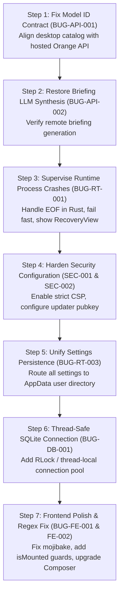

# ORANGE AI v2.0.0: RECOMMENDED REMEDIATION & FIX ORDER
**Sequenced, Dependency-Ordered Action Plan Before Authorizing Stage 5 JARVIS**

**Audit Execution Date:** 2026-11-20  
**Target Release:** Orange AI Desktop v2.0.0  
**Authorization Status:** **PROPOSED / PENDING SEPARATE AUTHORIZATION**  
*In accordance with strict change-control rules, no fixes have been applied. All remediation steps below are pending explicit user authorization.*

---

## 1. REMEDIATION PHILOSOPHY & SEQUENCING LOGIC

Remediation must proceed in strict dependency order:
1. **Phase 1: Backend Contract Alignment (Fix Core Inference)** — Restore basic end-to-end chat intelligence before addressing UI or supervision layers.
2. **Phase 2: Supervisor & Runtime Reliability (Fail-Closed Crash Handling)** — Ensure that unexpected runtime termination is cleanly detected and reported rather than hanging.
3. **Phase 3: Security & Code Integrity Hardening** — Establish Content Security Policy (CSP) and resolve updater signature requirements.
4. **Phase 4: Persistence Synchronization & Diagnostic Cleanup** — Unify split-brain settings files and resolve thread-safety risks in SQLite connections.
5. **Phase 5: Frontend Polish & Usability** — Correct chat timeline regex mojibake, prevent event listener leaks, and upgrade Composer controls.

---

## 2. SEQUENCED REMEDIATION ROADMAP



---

## 3. STEP-BY-STEP REMEDIATION SPECIFICATIONS

### STEP 1: Hosted Orange API Model Registry Alignment (BUG-API-001)
- **Priority:** **P1**
- **Affected Files:**
  - `D:\Orange AI\Orange AI Tauri\src\components\views\SettingsView.jsx`
  - `D:\Orange AI\Orange AI Tauri\runtime\runtime_adapter.py`
- **Action Required:**
  1. Update `FALLBACK_MODELS` in `SettingsView.jsx` to match the hosted Orange API's registered, available models:
     - `nvidia/nemotron-3.5-lightning-30b-a3b` (Default / Reasoning & Agentic)
     - `z-ai/glm-5.3-flash` (Fast Structured General)
  2. In `runtime_adapter.py:128`, update `DEFAULT_MODEL`:
     ```python
     DEFAULT_MODEL = "nvidia/nemotron-3.5-lightning-30b-a3b"
     ```
  3. Ensure `_model_aware_assist()` only passes valid model identifiers accepted by the remote backend.
- **Verification Criteria:**
  Send a live conversational turn with each model option; assert HTTP 200 and valid text return without HTTP 400 `Unknown model identifier`.

---

### STEP 2: Daily Briefing Synthesis Restoration (BUG-API-002)
- **Priority:** **P2**
- **Affected Files:**
  - `D:\Orange AI\Orange AI Tauri\runtime\runtime_adapter.py`
  - `D:\Orange AI\Orange AI Desktop\brain\briefing\synthesizer.py`
- **Action Required:**
  1. Ensure briefing synthesizer calls `api_client.send_chat(...)` using `nvidia/nemotron-3.5-lightning-30b-a3b`.
  2. Verify that `_evaluate_morning_briefing()` persists `daily_briefings` with `status: 'success'` and `model_name: 'nvidia:nvidia/nemotron-3.5-lightning-30b-a3b'`.
- **Verification Criteria:**
  Trigger morning briefing; assert `status == 'success'` and `model != 'local_deterministic'`.

---

### STEP 3: Rust Supervisor Post-Startup Crash Detection (BUG-RT-001)
- **Priority:** **P1**
- **Affected Files:**
  - `D:\Orange AI\Orange AI Tauri\src-tauri\src\python_runtime.rs`
- **Action Required:**
  1. Pass supervisor status reference into the stdout reader loop.
  2. When `read_until` returns `Ok(0)` (EOF):
     - Transition `*supervisor.status.lock().await = HandshakeStatus::ProcessTerminated`.
     - Drain all pending request channels in `pending_requests` with an immediate error: `Err("Python runtime terminated unexpectedly")`.
     - Emit `runtime_terminated` event to Tauri webview.
  3. In `ApplicationShell.jsx`, listen for `runtime_terminated` and trigger re-render of `App.jsx` to display `RecoveryView`.
- **Verification Criteria:**
  Kill child process during active turn; assert supervisor immediately reports `ProcessTerminated`, requests abort without 120s timeout, and `RecoveryView` appears.

---

### STEP 4: Content Security Policy & Updater Signing (SEC-001, SEC-002, SEC-003)
- **Priority:** **P1 / P2**
- **Affected Files:**
  - `D:\Orange AI\Orange AI Tauri\src-tauri\tauri.conf.json`
  - `D:\Orange AI\Orange AI Tauri\src-tauri\src\commands.rs`
- **Action Required:**
  1. Enforce strict CSP in `tauri.conf.json`:
     `"csp": "default-src 'self'; connect-src 'self' https://orange-api-cuuo.onrender.com; img-src 'self' data: asset:; style-src 'self' 'unsafe-inline'; script-src 'self';"`
  2. Configure a valid ed25519 public key in `plugins.updater.pubkey` (or disable the updater plugin until formal signing infrastructure is established).
  3. Replace `cmd.exe /C start` in `commands.rs` with Win32 `ShellExecuteW` or Tauri opener plugin.
- **Verification Criteria:**
  Verify clean Vite build and clean WebView2 loading without CSP violations; verify release URL opens without invoking `cmd.exe`.

---

### STEP 5: Settings Persistence Consolidation (BUG-RT-003)
- **Priority:** **P2**
- **Affected Files:**
  - `D:\Orange AI\Orange AI Desktop\gui\settings.py`
  - `D:\Orange AI\Orange AI Tauri\runtime\runtime_adapter.py`
- **Action Required:**
  1. In `gui/settings.py:19`, update `get_settings_path()` to use `get_user_data_dir()` unconditionally:
     ```python
     def get_settings_path() -> str:
         return os.path.join(get_user_data_dir(), SETTINGS_FILENAME)
     ```
  2. Verify that both the Tauri adapter and all core Python routines (`is_morning_briefing_enabled()`, etc.) read and write to `%LOCALAPPDATA%\Orange AI\gui_settings.json`.
- **Verification Criteria:**
  Update settings via RPC; assert that `brain.briefing.settings.is_morning_briefing_enabled()` immediately returns the updated value.

---

### STEP 6: Thread-Safe SQLite Connection Pool (BUG-DB-001)
- **Priority:** **P2**
- **Affected Files:**
  - `D:\Orange AI\Orange AI Desktop\brain\memory.py`
- **Action Required:**
  1. Add a re-entrant thread lock (`threading.RLock`) around `_conn` cursor executions in `memory.py`, or use thread-local connections via `threading.local()`.
  2. Ensure connection closing is serialized safely during quiescence.
- **Verification Criteria:**
  Run 20 concurrent threads performing interleaved memory reads, writes, and retractions without locked database errors.

---

### STEP 7: Frontend Polish, Mojibake Correction & Composer Upgrade (BUG-FE-001, FE-002, FE-003)
- **Priority:** **P2 / P3**
- **Affected Files:**
  - `D:\Orange AI\Orange AI Tauri\src\components\ApplicationShell.jsx`
  - `D:\Orange AI\Orange AI Tauri\src\components\Composer.jsx`
- **Action Required:**
  1. Fix mojibake in `ApplicationShell.jsx:144`:
     ```javascript
     const parts = replyText.split(/\n+(?:💡|\u{1F4A1})\s+\*\*Orange AI Advisory\*\*/u);
     ```
  2. Add `isMounted` guard inside `ApplicationShell.jsx:useEffect` to prevent lingering event listeners.
  3. Upgrade `Composer.jsx` to use an auto-resizing `<textarea>` supporting multiline input (Shift+Enter) and Enter to send.
- **Verification Criteria:**
  Verify that chat timeline cleanly strips duplicate advisory blocks when structured cards render; verify multiline input in Composer.

---

## 4. GATE CONDITIONS BEFORE STAGE 5 JARVIS ROADMAP

Stage 5 JARVIS development **must remain on hold** until:
1. Steps 1–4 are authorized, implemented, and verified with passing end-to-end regression suites.
2. A live conversational test confirms that inference through `https://orange-api-cuuo.onrender.com` succeeds with HTTP 200.
3. The user reviews and signs off on the completed remediation results.
